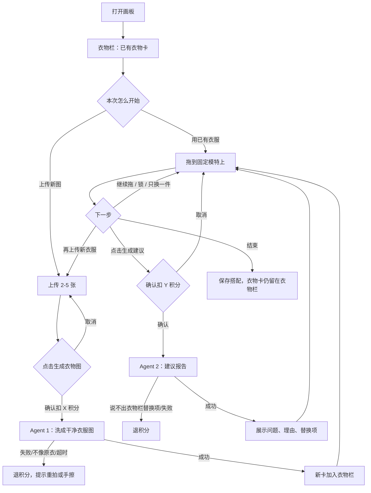

# AI 换装画板 PRD（首版）

依据：`AI换装画板调研方案.md`。本文只定义首版要做成什么样，调研结论不重复展开。

---

## 1. 产品定义

**一句话：** 用户把真实衣服拖到固定模特身上自己搭；需要时再让 AI 给建议。

**原则：** 用户负责创作。AI 只做两件事：把衣物照片洗成可拖的干净单品图，以及在用户点击后输出建议报告。

**成功标准：** 新用户打开网页后，几分钟内用自己的衣服完成一套搭配，并愿意再试第二套。

首页文案：

> 把你的衣服，拖到模特身上试试看。  
> 自己搭配，点击后让 AI 帮你看看怎么调整。

---

## 2. 范围

**做**

| 模块 | 能力 |
|---|---|
| 上传 | 一次 2–5 张新衣物图，一件一图；已生成的衣物卡留在衣物栏 |
| Agent 1 | 抠图、去背景、对齐，输出透明衣物卡和基础标签 |
| 画板 | 固定模特；拖拽、缩放、旋转、删除；锁定；同品类替换 |
| Agent 2 | 用户点击后，输出问题 + 已上传替换项的建议报告 |
| 衣物栏 | 已生成的衣物卡留下，下次可继续用，也可再传新图加入 |

**不做**

完整衣橱、账号社交、购物链接、多模特/场景/天气、3D/布料贴合、真人试穿大图、图转图摊平、自动改画板、全网商品推荐、复刻参考图。

---

## 3. 用户与场景

目标用户：有几件衣服想自己试试怎么搭，之后还会回来继续搭。

首版只服务三条：

1. 上传上衣、下装、鞋、外套，拖到模特上看效果。
2. 锁定一件，只换其他件。
3. 一件新衣服 + 几件旧衣服，看能不能搭。

衣物卡要能被找回，所以用户需要登录或等价的身份。不上传真人脸或身体照。

---

## 4. 页面与主流程

单页即可：左/下为衣物卡，中为固定模特画板，右/下为建议报告和积分提示。

---

## 5. 功能说明

### 5.1 上传与衣物栏

- 新图一次 2–5 张，jpg/png。
- 引导：一件一拍、平铺或挂拍、背景尽量干净、正面为主。
- 拒绝：明显多件同框、纯空白、非衣物图。穿拍/侧拍可传，但提示效果可能差。
- 上传本身不扣积分。
- 已生成的衣物卡默认留在衣物栏。下次打开可直接拖旧卡，也可再传新图。
- 用户可删除单件衣物卡；删除后不可再拖，需重新生成才可用。

### 5.2 Agent 1：衣物图处理

用户点击「生成衣物图」后扣 **X 积分**。同一批图不重复扣；生成成功的衣物卡留下后，下次再用不再扣。

输出每件：

- 透明 PNG 衣物卡（尽量保住颜色、图案、Logo、版型）
- 标签：品类、主色、长短；品类至少覆盖上衣、下装、外套、鞋；无法判断则标「其他」，仍可拖，但不参与同品类自动替换
- 质量状态：可用 / 需手擦 / 失败

规则：

- 用检测 + 抠图 + 裁切对齐，**不用图转图**。
- 不补全被遮挡的袖口、后背。
- 需手擦：给出简单擦背景工具，不另扣积分。
- 失败、明显不像原衣、超时：退积分，请用户重拍。
- 首版接受略有角度的干净贴纸，不承诺电商平铺图。

### 5.3 换装画板

纯前端，不调模型、不扣积分。

- 一个固定模特或人体轮廓。
- 衣物卡可拖入、移出、缩放、旋转、删除。
- 默认层级：鞋 < 下装 < 上衣 < 外套 < 其他。
- 同品类互斥：拖入新裤子，旧裤子回到衣物栏。
- 锁定：锁定件不被同品类替换，Agent 2 不得建议替换它。
- 可做简单吸附（上衣-躯干、下装-腰、鞋-脚）；吸附失败仍允许自由放置。
- Agent 2 返回后，用户自己决定是否替换，系统不自动改画板。

### 5.4 Agent 2：建议报告

画板上至少 2 件衣物时，「生成建议」可点。点击前显示扣除 **Y 积分**。

输入：当前画板单品、锁定状态、图层；各衣物标签；缩略图；衣物栏中未上板的同品类候选（含旧卡和新卡）。

输出报告必须包含：

1. 问题：点名哪一件，例如「黑鞋让下半身过重」
2. 理由：颜色 / 比例 / 基本风格，三选一或组合，不空泛说「不好看」
3. 替换项：指向衣物栏里的具体某件，例如「试试那双白鞋」

失败并退积分：

- 超时或服务不可用
- 建议没有点名衣物栏里的具体单品
- 推荐了衣物栏里没有的衣服
- 建议替换已锁定的衣服

用户看完报告后自己拖；可再点一次建议（再扣 Y）。不做天气、场合、体型、潮流判断。

### 5.5 保存与衣物栏

- 保存搭配：生成本次搭配图 + 衣物清单，可回看。
- 衣物卡：生成成功后留在衣物栏，跨次使用。原图处理完不长期保存。
- 用户可删除单件衣物卡，或删除某次搭配记录。

---

## 6. 积分

| 动作 | 积分 |
|---|---|
| 上传、拖拽、缩放、旋转、删、锁定、改图层、手擦、查看或再用已生成衣物卡 | 0 |
| 生成衣物图 | X，同一件/同一批只扣一次，留下后不再扣 |
| 生成建议报告 | Y，每次点击扣一次 |

点击前展示扣除数量。取消不扣。失败自动退。X / Y 数值另测，不在本 PRD 锁死。

首版：积分包付费；无免费额度、无会员档、无电商佣金。若转化过差，另立体验包实验，不改上述扣费点。

---

## 7. 验收标准

必须同时满足：

1. 平铺/挂拍的衣物，Agent 1 多数能出可拖的透明卡，且用户能认出是自己的衣服。
2. 新用户 30 秒内知道怎么玩，2 分钟内能搭完一套。
3. 锁定和「只换一件」可用。
4. 拖拽不扣积分，用户敢反复试。
5. Agent 2 每次成功报告都点名已上传的具体单品，且不改画板。
6. 失败会退积分。已生成衣物卡下次打开仍在；用户删除单件后才不可再用。

不通过即不算首版完成：穿拍也要完美抠图、衣服像穿在身上、建议像造型师、或必须注册才能用。

---

## 8. 非功能

- Web 首版，桌面优先，窄屏可用但不做独立 App。
- Agent 1 / 2 需有超时和失败态，不能让画板假死。
- 不上传、不要求人脸和真实身体照。
- 日志可留匿名处理状态，不把原图当训练数据。
