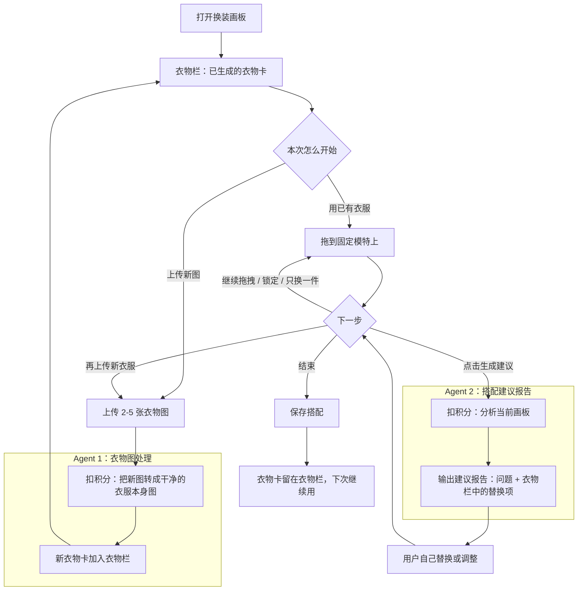

# AI 换装画板调研方案

## 1. 结论

暂定名称：**AI 换装画板**。

> 用户把真实衣服拖到固定模特身上自己搭。Agent 只做两件事：把衣物照片洗成可拖的干净单品图，以及用户点击后再给搭配建议。

核心原则：**用户负责创作，AI 只处理衣物图和可执行建议。**

---

## 2. 主流程

Agent 只出现两处：新衣服第一次生成衣物卡；用户点击后给出建议报告。已经生成的衣物卡留在衣物栏，下次打开可直接用，也可再传新图加进去。中间拖拽全部是用户操作，Agent 不自动改画板。同一件衣服不重复扣生成积分。

---

## 3. 痛点与空位

现有产品已经分别把「管衣橱」「拼图片」「生成试衣图」做熟了。空位不在再做一个更全的衣橱，而在：**用自己的衣服、自己拖、需要时再给具体建议。**

### 3.1 别人做什么，我们因此做成什么样

| 产品 | 他们做什么 | 本方案因此强调 |
|---|---|---|
| [尽简衣橱](https://closet.jinjian.tech/zh-Hans) | 完整电子衣橱、单品档案、统计、多衣橱管理 | 先有几张图就能开始；生成后的衣物卡留下，下次继续用 |
| [Acloset](https://www.acloset.app/) | AI 识别 + 衣橱管理 + 自动推荐 | 打开就能搭，用户自己组合 |
| [Whering](https://whering.co.uk/) | 社交化衣橱、日历、灵感和愿望清单 | 衣物卡可留下接着搭，不做日历和社区 |
| [Indyx](https://www.myindyx.com/) | 衣橱整理 + 人工造型服务 | 用户自己完成搭配 |
| [Cladwell](https://cladwell.com/) | 胶囊衣橱，系统决定今天穿什么 | 用户自己搭，系统给建议 |
| [Stylebook](https://stylebookapp.com/) | 自动抠图 + 手动搭配 + 衣橱记录，最接近本方案 | 保留拖拽；补上锁定、只换一件，以及按已上传衣服给的解释式建议 |
| [Combyne](https://www.combyne.com/) | 用现成单品拼穿搭，可社交展示 | 只用用户自己的真实衣服 |
| [ShopLook](https://shoplook.io/) | 穿搭拼图和灵感收藏 | 衣物是可拖资产；建议能换成某件已上传衣服 |
| AI 试衣 / 生图 | 生成模特上身效果，换姿势、背景、模特 | 保真原衣，允许只换一件 |

### 3.2 能力对照

| 能力 | 衣橱管理 | 拖拽拼搭 | AI 试衣 / 生图 | 本方案 |
|---|---|---|---|---|
| 用自己的真实衣服 | 有，但要先建完整库 | 少，多为现成图 | 有时有，不保证保真 | 有。可先传几张，生成后的衣物卡留下接着用 |
| 自己拖到模特上 | Stylebook 有 | 有 | 弱 | 有 |
| 原衣颜色 / 图案 / 版型 | 抠图为主 | 不涉及 | 弱，容易被生成改写 | 抠图保真 |
| 锁定、只换一件 | 弱 | 弱 | 弱 | 有 |
| 解释式搭配建议 | 多为自动推荐 | 无 | 无 | 点击后出报告，点名已上传单品 |

用户真正想看的是：我自己的这件衣服，搭起来究竟是什么效果？

---

## 4. 问题与结论

**现有衣橱 / 拼搭 / AI 试衣分别卡在哪？**  
衣橱类先建库，价值来得太晚。拼搭类能玩，但往往不是自己的衣服，拼完也没有判断。试衣类图好看，衣服不一定还是原来那件，也不能精确只换一件。

**「真实衣物 → 拖到模特 → 按需建议」有没有空位？**  
有。上表里没有产品同时做到这三步。

**用户是否愿意为「处理衣物图」和「搭配建议」付费？**  
方案按此设计：只对这两类 Agent 动作收积分，拖拽免费；用积分包购买。

**第一版做什么？**  
衣服照片 → 干净可拖衣物卡，并留在衣物栏；固定模特画板（拖拽、缩放、删、图层、锁定）；下次可继续用旧卡或再传新图；用户点击后，从衣物栏里给建议报告。

---

## 5. 首版范围

一句话：把真实衣服拖到固定模特身上自己搭，需要时再让 AI 给建议。

**体验约束**

- 新衣服按批上传，一次 2–5 张。
- 某件衣服一旦生成衣物卡，就留在衣物栏，下次打开仍可拖，不必再生成。
- 用户可继续上传新图，新卡加入同一衣物栏，和旧卡一起搭。
- Agent 只在两处工作：给新图生成衣物卡；生成搭配建议。拖拽全在前端。
- 建议点名衣物栏里的某件衣服，用户自己决定是否替换。
- 衣物图是可拖素材。边缘清楚、能认出来就能拖。

文案：

> 把你的衣服，拖到模特身上试试看。  
> 自己搭配，点击后让 AI 帮你看看怎么调整。

---

## 6. 可行性分析

本方案能落地，是因为它把能力拆成三块，每块都有现成做法。

| 模块 | 做什么 | 怎么落地 |
|---|---|---|
| Agent 1 | 上传图 → 干净衣服本身图 | 检测 + 抠图 + 裁切对齐 |
| 换装画板 | 拖到固定模特上 | 前端贴纸画板 |
| Agent 2 | 建议报告 | 多模态分析当前画板 + 已上传衣物 |

### 6.1 Agent 1：衣物图处理

目标是**尽量保住原衣，得到一张能拖的透明单品图**。

技术路径：衣服检测 → 分割/抠图 → 去背景 → 裁切、对齐、统一缩放 → 打品类/颜色/长短标签。

输入约束：

- 引导用户一件一拍、平铺或挂拍、背景尽量干净、正面为主。
- 穿在身上、严重遮挡、极端侧拍：提示重拍或手动擦背景。
- 抠不干净按质量分级：能用就输出透明卡；边缘毛让用户补一刀；失败则退积分。

首版输出「略有角度的干净贴纸」，让用户认得出自己的衣服。

### 6.2 换装画板：前端即可

拖、放、锁、换层是普通画板交互。

固定一张模特图或人体轮廓；衣物是透明 PNG；可拖拽、缩放、旋转、删除。图层：鞋 < 裤 < 上衣 < 外套。同品类互斥。锁定后保持不变。可做简单吸附。

### 6.3 Agent 2：建议报告

检索范围是用户衣物栏里已生成的衣服，包括旧卡和新卡。

输入：当前画板单品、位置和图层、品类/颜色/长短，外加缩略图。输出报告：哪件有问题、为什么、建议换成哪件已上传衣服。用户自己替换。

建议必须点名衣物栏里的具体单品；否则判定本次失败并退积分。

成本结构：新图第一次生成衣物卡扣一次积分，之后再用这张卡不扣；搭配建议按次扣。拖拽全在浏览器。留下的是衣物卡，原图处理完即可丢掉。

---

## 7. 隐私与计费

**隐私：** 留下的是已生成的衣物卡，原图处理完不长期保存。用户可删除单件衣物卡。

**计费：** 积分只打在两类 Agent 动作上。手动搭配、再用旧卡全部免费。

| 动作 | 积分 |
|---|---|
| 上传、拖拽、缩放、删、改图层、查看或再用已生成衣物卡 | 0 |
| 生成衣物图 | 固定积分，同一件/同一批只扣一次，留下后不再扣 |
| 生成搭配建议 | 固定积分，每次点击扣一次 |

点击前显示扣除数量。取消或继续拖不扣；失败、不像原衣、超时自动退还。
