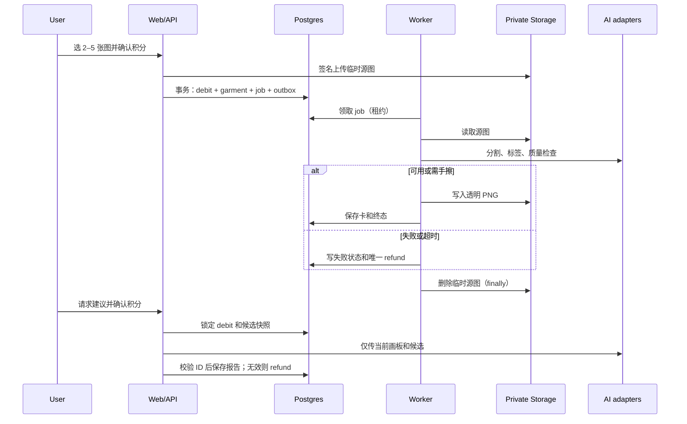

## Context

项目是空白目录；本设计为 `proposal.md` 中的首版能力建立第一个可部署边界。详细行为以本变更的 5 份规格为准。首版是桌面优先 Web，不要求人脸或人体照；AI 只负责衣物卡处理和用户主动请求的建议。

## Goals / Non-Goals

**Goals:**

- 在一个代码库中交付可独立扩展的 Web、API 和后台任务，而不把耗时图像调用放进浏览器或请求线程。
- 把积分扣减、任务状态和退款做成可恢复的事务流程。
- 保存透明衣物卡和搭配，原始照片只在私有临时区保留到处理完成。
- 让画板交互完全由客户端完成，AI 输出始终经服务端候选集校验。

**Non-Goals:**

- 不实现图生图、虚拟试穿、自动改画板、商品搜索、完整衣橱管理或移动端原生 App。
- 不在首版实现多模特、3D 布料贴合、社交、日历或天气/场合推荐。
- 不把外部视觉模型供应商的私有 API 类型传播到领域模型或前端。

## Decisions

### 1. 使用 TypeScript 单仓库和异步 Worker

采用 `pnpm` workspace：`apps/web` 是 Next.js（App Router）Web/BFF，`apps/worker` 是独立 Node.js 任务进程，`packages/domain` 放领域类型、状态机和 Zod 输入/输出模式，`packages/db` 放 Drizzle schema 与迁移。Web 通过同一域名的 JSON API 提供业务能力；Worker 从 PostgreSQL 队列表取任务。

选择原因是首版只有一套 Web 客户端，TypeScript 可复用数据模型；图像分割、质量检查和多模态调用会超出 Web 请求时限，因此必须脱离请求线程。备选的“所有逻辑放 Next.js Route Handler”会让超时、重试和退款难以可靠处理；一开始拆成多套微服务则会增加空项目的运维成本。

### 2. 使用 Supabase 托管 PostgreSQL、认证和私有对象存储

Supabase Auth 负责邮件魔法链接，PostgreSQL 是唯一业务事实来源，私有 Storage 保存临时源图、透明衣物 PNG、手擦后的 PNG 和搭配渲染图。服务端以 cookie 中的匿名会话或 Supabase 用户 ID 解析 `owner_id`；魔法链接绑定在一个数据库事务中迁移匿名资源所有权。

源图存入 `sources/{jobId}/...`，衣物卡存入 `garments/{ownerId}/{garmentId}/...`。浏览器只能获取最短期的签名上传/读取 URL；数据库只保存对象键，不保存公开 URL。备选的本地磁盘不支持部署和清理；将图片设为公开桶不符合隐私要求。

### 3. 以 Postgres 任务表和 outbox 实现可恢复的处理状态机

创建 `processing_jobs` 表，状态为 `queued → running → succeeded | needs_cleanup | failed | timed_out`。确认处理时在一个数据库事务内创建：衣物记录、`credit_debit` 流水、任务和 outbox 事件。Worker 用 `FOR UPDATE SKIP LOCKED` 领取任务，并使用租约、指数退避和最大尝试数恢复崩溃任务。终态失败通过唯一约束的 `refund_for_ledger_id` 创建退款。

这比在支付后直接调用模型可靠：API 进程重启或网络超时不会漏退款或重复扣款。初期不引入 Redis 或 SaaS 队列；如果吞吐量超过 Postgres 队列能力，可在不改变状态机契约的前提下替换消费者。

### 4. 建立稳定的图像和建议供应商适配接口

`GarmentProcessor` 接口接受私有源图并返回透明 PNG、检测标签和供应商置信信息；实现只允许检测、分割、去背景、裁切和对齐。`QualityGate` 使用分割置信度、图像完整性检查和源图/输出的视觉一致性检查，返回 `usable`、`needs_cleanup` 或 `failed`。选择供应商前，先用受授权的平铺、挂拍、侧拍和穿拍样本集完成 POC；达标阈值和人工抽检结果记录在运营配置中。

`StylingAdvisor` 接口接收归一化画板、候选衣物 ID 和缩略图，强制返回 JSON Schema：`issueItemId`、`reason`、`replacementGarmentId`、`summary`。服务端以请求快照和实时所有权再校验这两个 ID；不合格结果一律失败退款。备选“让前端直接调用模型”会泄露密钥且不能证明候选合法；将模型返回文本直接展示会允许虚构衣物。

### 5. 画板状态以归一化坐标和不可变快照保存

`look_items` 保存 `garment_id`、`asset_version`、`x`、`y`、`scale`、`rotation`、`layer`、`locked` 和 `category_snapshot`。`x/y/scale` 相对固定画板尺寸归一化，因此屏幕尺寸变化不会改变构图。客户端用 React Konva 绘制固定模特和透明卡，并在一次交互结束时做节流保存；导出搭配时由服务端或受控渲染任务生成快照。

同品类替换与锁定首先在客户端即时执行，保存 API 再使用同一领域规则校验。历史搭配引用 `asset_version` 快照，删除衣物后显示占位，不回写历史。备选只保存一张合成图会使编辑、锁定和建议输入不可恢复。

### 6. 积分使用不可变流水和预留式结算

`credit_ledger` 是余额唯一来源，类型为 `purchase`、`debit`、`refund`、`adjustment`。确认请求先创建关联 `operation_key` 的 debit；下游成功时标记操作完成，失败时插入唯一退款。余额检查和 debit 在同一事务中串行化该用户钱包行。价格从服务端产品配置读取，浏览器只能显示，不能提交价格。

生产购买通过 `PaymentProvider` 接口实现微信支付 v3：创建订单、接收签名 webhook、以支付单号唯一化入账。开发和测试环境只启用受审计的管理员补发，不模拟成功支付。备选直接更新余额会无法对账，也无法安全处理重复 webhook。

### 7. 以“尽快删除”为原图生命周期，而非仅依赖生命周期规则

Worker 在所有终态路径的 `finally` 中删除源图和临时签名记录；Storage 生命周期规则作为 24 小时兜底。图片请求、模型提示、异常日志和分析事件只记录任务 ID、类型、耗时、质量状态和去标识化指纹，绝不记录源图 URL 或二进制。删除衣物卡/搭配采用“先撤销访问，再异步删除文件，最后清除元数据”的 outbox 流程，删除失败会告警重试。

只靠 Storage 生命周期会在成功完成后仍保存原图过久；在 HTTP 日志中记录签名 URL 会使私有桶形同虚设。

## Data Model

| 表 | 关键字段 | 用途 |
| --- | --- | --- |
| `owners` / `anonymous_sessions` | `id`, `account_id`, `status` | 统一匿名和已绑定数据所有者。 |
| `wallets` / `credit_ledger` | `owner_id`, `balance`, `operation_key`, `refund_for_ledger_id` | 串行余额与不可变结算记录。 |
| `garment_batches` / `garments` / `garment_assets` | `owner_id`, `source_hash`, `category`, `quality_status`, `object_key`, `version` | 批次、衣物卡及可编辑透明资源。 |
| `processing_jobs` / `outbox_events` | `kind`, `state`, `lease_until`, `attempts`, `payload` | 图像处理、删除和渲染的可靠异步执行。 |
| `looks` / `look_items` | `owner_id`, `render_key`, `garment_id`, `transform`, `locked` | 可恢复的搭配及其不可变单品快照。 |
| `advice_requests` | `owner_id`, `look_snapshot`, `candidate_ids`, `ledger_id`, `result` | 建议的审计、校验和退款关联。 |
| `payment_orders` | `provider`, `provider_order_id`, `state`, `credits` | 微信支付 webhook 的幂等入账。 |

所有归属表以 `owner_id` 做行级访问控制；服务端 Worker 使用专用服务角色，并在业务查询中显式带入 owner 过滤条件。

## Request and Processing Flow

## Risks / Trade-offs

- [抠图质量在穿拍、遮挡和花纹衣物上不足] → 上传前提示、POC 样本门槛、质量三态、手擦和自动退款；首版不承诺电商平铺效果。
- [模型超时或供应商限流导致用户已付费无结果] → Worker 重试、总超时、操作幂等和唯一退款；监控供应商错误率。
- [同一扣费被并发请求或 webhook 重放] → 钱包行锁、`operation_key`/支付单号唯一索引和事务内写流水。
- [匿名 cookie 丢失导致无法找回] → 明确提示匿名数据只在当前设备可用，并在首次购买或跨设备动作前引导绑定邮箱。
- [画板在不同设备显示偏移] → 归一化变换、固定画板比例和桌面优先验收；窄屏只保证可用。
- [存储或日志泄露原图] → 私有桶、短期签名 URL、日志脱敏检查和终态删除告警。

## Migration Plan

1. 以全新项目创建数据库迁移、私有桶、行级访问控制、服务账号和环境变量；在 staging 使用独立项目和测试支付凭据。
2. 先部署只包含匿名画板和模拟衣物卡的 feature flag，再启用真实上传 Worker；确认处理成功率、退款率和临时源图删除指标。
3. 启用建议服务和微信支付前，分别完成输出 Schema 回归集与支付 webhook 签名/重放测试。
4. 每项付费能力由独立 feature flag 控制。回滚时停止新任务和新扣费、保留既有衣物/搭配可读；对进行中的已扣费任务由 Worker 终态退款，绝不删除用户透明衣物卡。
